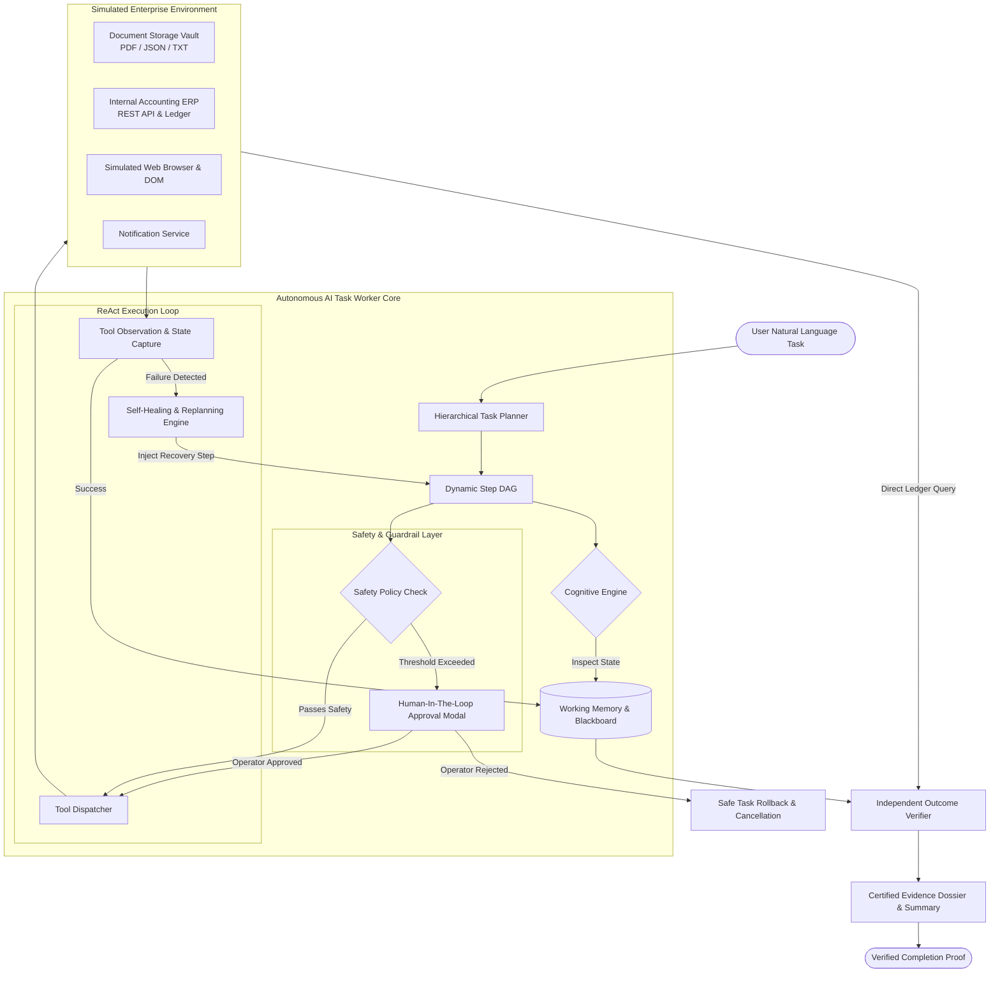

# Autonomous AI Task Worker: Architecture & Design

This document details the architectural blueprint, cognitive lifecycle, safety guardrails, and technical trade-offs behind the **Autonomous AI Task Worker Prototype**.

---

## 1. System Philosophy & Core Design Principles

Traditional Robotic Process Automation (RPA) requires rigid, brittle point-to-point scripts that break whenever a UI element shifts, an API schema adjusts, or an edge-case document appears. Conversely, naive LLM wrappers generate conversational text about what *ought* to be done without actually interacting with systems or validating ground-truth state changes.

The **Autonomous AI Task Worker** is architected on five foundational tenets:

1. **Goal-Oriented Autonomy**: Decomposing natural language intents into execution directed acyclic graphs (DAGs) rather than requiring procedural step-by-step instructions.
2. **Execution Over Conversation**: Actually operating filesystems, browser DOMs, REST APIs, and enterprise ledgers.
3. **ReAct Closed-Loop Reasoning**: Every action produces an observation, recorded in working memory, which conditions subsequent actions.
4. **Resilient Self-Healing**: Automated failure classification, intelligent parameter normalization, and dynamic fallback execution.
5. **Independent Outcome Verification**: Post-execution verification against target databases rather than trusting intermediate HTTP status codes.
6. **Human-in-the-Loop (HITL) Guardrails**: Enforcing safety boundaries and policy thresholds (e.g., spend limits or ambiguity) before high-risk changes occur.

---

## 2. High-Level Architecture Diagram

---

## 3. Subsystem Breakdown

### 3.1 Hierarchical Task Planner (`core/planner.py`)
- Analyzes natural language instructions and extracts semantic constraints (entities, source locations, target systems).
- Decomposes the high-level intent into an initial sequence of execution steps (`PlanStep`).
- Handles dynamic step injection for error recovery and alternative execution paths.

### 3.2 Dual Cognitive Engine (`core/llm_engine.py`)
- **Local Autonomous Engine**: A deterministic reasoning engine that extracts entities, handles error heuristics, and constructs audit summaries without cloud API keys. Ensures zero-friction local execution.
- **External LLM Engine**: Pluggable adapter supporting Google Gemini (`gemini-1.5-flash`), Anthropic, or OpenAI when an API key is provided via environment variables.

### 3.3 Working Memory & Blackboard (`core/memory.py` & `core/models.py`)
- **Entity Store**: Key-value registry holding discovered facts (`vendor`, `invoice_number`, `amount`, `due_date`, `erp_record_id`, `checksum`).
- **Observation Scratchpad**: Chronological audit of observations made after each tool invocation.
- **Location Tracker**: Record of files read and endpoints queried.
- **Error History**: Detailed record of encountered exceptions and remediation attempts.

### 3.4 Pluggable Tool Registry (`tools/`)
All tools inherit from `BaseTool` (`tools/base.py`) providing automatic timing, parameter schema validation, and structured `ToolResult` generation:
- `FileSearchTool`: Scans directories with recursive globbing and vendor keyword matching.
- `DocumentReaderTool`: Extracts text and metadata from PDF files (`pypdf`), JSON, and plain text.
- `InvoiceEntityExtractorTool`: Parses invoice text using regex NLP heuristics to extract critical billing fields.
- `ERPPostInvoiceTool`: Posts invoices into the internal ERP ledger with field validation.
- `ERPListInvoicesTool`: Queries the ERP for historical and current invoices.
- `ERPVerifyInvoiceTool`: Runs ledger queries for verification.
- `BrowserNavigateTool`, `BrowserInspectDOMTool`, `BrowserFillFormTool`, `BrowserClickButtonTool`: Simulated browser tools for DOM interaction.
- `NotificationDispatcherTool`: Dispatches messages and evidence proofs to simulated Slack/Email channels.
- `DateNormalizerTool`: Parses and normalizes varied date representations into ISO 8601 (`YYYY-MM-DD`).

### 3.5 Human-in-the-Loop (HITL) Guardrails (`core/guardrails.py`)
Automated agents operating financial or irreversible actions can cause damage if unconstrained.
- **Threshold Policy (`POLICY-FIN-001`)**: Any ingestion exceeding a configured dollar limit (default: $5,000.00) triggers a state transition to `WAITING_FOR_APPROVAL`.
- The worker emits an `ApprovalRequest` and safely pauses execution.
- When an operator approves or rejects via the Web UI or CLI, the agent safely resumes or rolls back.

### 3.6 Independent Outcome Verifier (`core/verifier.py`)
Rather than trusting that an intermediate HTTP 200 means success:
1. Queries the target ERP ledger by record ID and invoice number.
2. Performs precision amount comparison (`abs(stored - expected) < 0.01`).
3. Validates date format and string equivalence.
4. Checks SHA-256 cryptographic ledger checksums to ensure zero data corruption.
5. Produces a signed `VerificationResult` containing individual checks.

---

## 4. Key Architectural & Design Decisions

### Decision 1: Separation of Execution and Verification
- **Rationale**: Agents that grade their own work by checking only return codes are prone to silent errors. By creating an independent verifier that inspects target database state, false-positive completions are prevented.

### Decision 2: Self-Contained Simulated Enterprise Environment
- **Rationale**: Real company portals require authentication, private VPNs, and risk real financial side effects. We built a realistic in-memory ERP and document vault with real PDFs, validation errors, and audit logs. This produces authentic, reproducible behavior.

### Decision 3: Dual Cognitive Architecture (Local + LLM)
- **Rationale**: Evaluators often face broken demos due to missing API keys, rate limits, or network firewalls. Providing a local deterministic engine alongside external LLM adapters guarantees that the prototype works immediately while remaining extensible.

### Decision 4: Reversible Step DAG with Dynamic Recovery Injection
- **Rationale**: When an action fails (e.g. date format error from ERP validation), the agent shouldn't immediately crash. The planner dynamically injects a recovery step (`date_normalizer`) ahead of the failed step and retries with corrected parameters.
